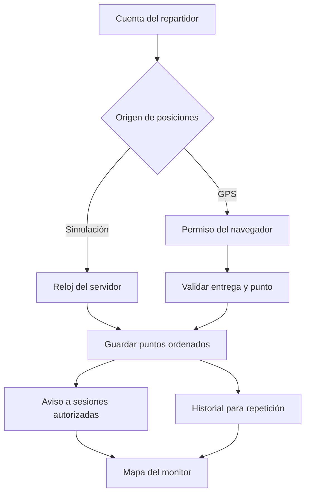

# Arquitectura del ERP Comercial Perú

## Decisión de alcance

La aplicación recibida ya separaba las pantallas de React, las operaciones comerciales puras y los cálculos de inventario. También tenía pruebas de ventas, compras, devoluciones y conciliación. El problema para una entrega en vivo era la frontera del almacenamiento. Persona 1 escribía en su navegador y Persona 2 tenía otro almacenamiento.

La versión de clase introduce un **monolito modular** para identidad, logística y asistente. Un proceso Node sirve la interfaz y la API bajo el mismo origen. La transacción logística ya se comparte entre dispositivos. Los módulos comerciales originales siguen funcionando con su formato de datos. PostgreSQL y los servicios por dominio forman el diseño de evolución para operaciones empresariales multiusuario.

## Las cinco capas

| Capa | Implementación en el ZIP | Responsabilidad y evolución recomendada |
| --- | --- | --- |
| **ATRÁS** · servicios de negocio | `server/api.mjs`, `accounts.mjs`, `tracking.mjs`, `assistant.mjs`. API REST, sesiones de servidor, reglas por rol y asignación, límites de entrada y auditoría. | Mantener contratos separados de Identidad, Comercial, Inventario, Finanzas, Reparto y RR. HH. Migrar cada operación por comando de dominio. Dividir en microservicios cuando necesiten despliegue o escalado independientes. |
| **TIERRA** · datos y sincronización | `server/schema.sql` y `position-repository.mjs`. SQLite con claves foráneas, índices, transacciones y WAL. Los eventos SSE avisan al cliente y la consulta incremental recupera los puntos. El estado comercial conserva el formato v2. | PostgreSQL para relaciones y contabilidad, claves compuestas por organización, RLS, transacciones, índices por acceso y proyecciones de lectura. Mantener la caché por empresa y usuario, con caducidad y revisión de versión. |
| **SOL** · analítica y asistente | Reportes en Excel/PDF, indicadores, proyección mensual reproducible y un asistente con herramientas concretas. Los comandos básicos funcionan sin clave. Gemini es un adaptador opcional. | Crear vistas de ventas, cartera y rotación. Evaluar un pronóstico contra períodos reservados antes de sustituir el promedio móvil. Registrar herramientas, rol, entidad, confirmación y resultado. |
| **LUNA** · interfaz | React, TypeScript, React Router, módulos diferidos y componentes de formulario existentes. El repartidor y el monitor entran directamente al mapa. Hay selección de puntos A/B por mapa o coordenadas, señal de antigüedad y registro textual. | Separar paneles operativos, de supervisión y auditoría. Mantener textos y navegación por tarea, validaciones de teclado y revisión de contraste según WCAG 2.2 AA. |
| **ANIMACIONES** · interacción | Esqueletos de carga, botones ocupados, confirmaciones, estados de conexión y reproducción por marcas de tiempo. CSS respeta `prefers-reduced-motion`. | Aplicar transiciones breves a propiedades visuales. Mantener las animaciones independientes de las escrituras y de los datos del libro contable. |

## Un recorrido de extremo a extremo



**Estado de la entrega.** Al crearla queda `lista`. Solo el repartidor asignado puede iniciarla. En `en_ruta` se aceptan puntos GPS o se materializa la secuencia simulada, según el modo elegido. El servidor permite una sola entrega en curso por repartidor. La simulación termina automáticamente en B. Para GPS, el repartidor confirma la llegada y el servidor comprueba proximidad, antigüedad y precisión. Una cancelación cierra la entrega y conserva su historial.

**Tras una desconexión.** Cada punto tiene una secuencia y una marca temporal. El navegador recuerda en memoria la última secuencia recibida y solicita las posteriores. Un aviso SSE contiene el ID de la entrega. El servidor vuelve a verificar la sesión y la asignación al responder la consulta. La reconexión de SSE y una lectura de respaldo cada 12 segundos recuperan las notificaciones perdidas. La entrega simulada conserva su hora de salida en la base y recupera los pasos pendientes después de reiniciar Node.

**Captura en el teléfono.** El permiso se pide al pulsar el botón de GPS. Se conserva en memoria la lectura pendiente más reciente ante un corte corto. El servidor descarta fechas antiguas y conflictos de orden, y reconoce un reintento idéntico. Las interrupciones largas dejan un hueco real entre observaciones. La repetición une las posiciones en el orden guardado. La distancia acumulada aproxima la longitud de esa poligonal. La distancia restante mide la separación en línea recta hasta B.

**SSE o WebSocket.** En clase, el dispositivo envía sus muestras por HTTP y el monitor recibe notificaciones en una dirección. SSE conserva la conexión con el navegador y permite recuperarse usando el cursor de datos. Para una flota con órdenes bidireccionales y confirmaciones del conductor, el diseño admite un gateway WebSocket con canales privados por empresa y entrega, heartbeat, secuencia y recuperación desde PostgreSQL. Los servicios publicarían los eventos confirmados mediante un outbox transaccional y un bus compartido. [Eventos enviados por el servidor](https://developer.mozilla.org/en-US/docs/Web/API/Server-sent_events/Using_server-sent_events)

## Contratos implementados

| Método y ruta | Quién lo usa | Resultado |
| --- | --- | --- |
| `POST /api/login`, `GET /api/me`, `POST /api/logout` | Titular de la cuenta | Inicia, consulta y revoca la sesión. |
| `GET/PUT /api/users` | Administración | Lista cuentas y crea o edita una cuenta de la organización. |
| `GET /api/directory` | Quien coordina una entrega | Devuelve nombres e IDs elegibles para reparto y monitoreo. |
| `GET/POST /api/trips` | Asignados, coordinador o administración según la acción | Lista visible o creación idempotente. La referencia de pedido evita asignaciones duplicadas. |
| `POST /api/trips/{id}/iniciar` y `/points` | Repartidor asignado | Comienza el trayecto y registra muestras de GPS válidas. |
| `GET /api/events`, `GET /api/trips/{id}?after=N` | Sesiones autorizadas | Avisos y lectura del estado con puntos posteriores a N. |
| `POST /api/trips/{id}/finalizar` o `/cancelar` | Repartidor, con cancelación disponible al coordinador o administrador | Transición autorizada y auditada. |
| `POST /api/assistant`, `POST /api/assistant/confirm` | Usuario autenticado | Respuesta o propuesta, seguida de un comando sujeto al rol. |
| `GET /api/audit` | Administración | Los 100 eventos de cuentas y logística más recientes de la organización. |

Los cuerpos usan JSON. La API distingue sesión caducada (401), acceso denegado (403), entrega ajena o inexistente (404), conflicto de estado (409), entrada inválida (422) y límite de solicitudes (429).

## Conexión de ATRÁS con TIERRA

El caso ejecutable está en `server/tracking.mjs` y `server/position-repository.mjs`. La capa HTTP obtiene al actor de la cookie, y el servicio carga una entrega visible antes de comprobar que el actor puede escribir en ella. Este es el tramo final, posterior a validar rol, estado, coordenadas, antigüedad y posibles duplicados.

```js
const seq = (last?.seq || 0) + 1;
requireThat(seq <= 30000, 422, 'Se alcanzó el límite de muestras de esta entrega.');
positions.append(id, { seq, lat, lng, at, accuracy });
publish(row);
return { seq };
```

El repositorio prepara la sentencia una vez y enlaza los valores por parámetros. La PK `(trip_id, seq)` fija el orden y `UNIQUE(trip_id, at)` evita duplicados. El proceso de aula ejecuta esas escrituras síncronas en SQLite. Un fallo de notificación posterior al guardado se recupera consultando el cursor. Para varias instancias, se debe asignar la secuencia y crear el evento outbox en una misma transacción PostgreSQL con bloqueo por entrega.

## Modelo relacional de Inventario y Finanzas

El archivo `database/postgresql.sql` define el esquema objetivo. Se puede aplicar una vez en una base PostgreSQL vacía mediante `psql -v ON_ERROR_STOP=1 -d erp_clase -f database/postgresql.sql`. La aplicación de aula usa el esquema SQLite independiente incluido en `server/schema.sql`.

| Tabla | Clave y relación | Regla de negocio |
| --- | --- | --- |
| `empresa`, `producto`, `almacen` | Empresa como raíz, entidades con PK `(tenant_id,id)` | El SKU es único dentro de la empresa. Las FK compuestas impiden cruzar empresas. |
| `movimiento` | Producto, almacén, operación y número de línea | Kardex de deltas con signo, actor y referencia. Los asientos de stock son inmutables. Una transferencia registra dos líneas en una transacción. |
| `existencia` | PK `(tenant_id,producto_id,almacen_id)` | Un trigger aplica el delta al saldo con una condición atómica. Una salida que deja saldo negativo aborta toda la operación. |
| `tercero`, `cuenta` | Documento y código contable únicos por empresa | Maestro de contrapartes y plan de cuentas para activos, pasivos, patrimonio, ingresos y gastos. |
| `asiento`, `apunte` | Cabecera y líneas por empresa, asiento y número | Una línea tiene debe o haber positivo. Para contabilizar hacen falta al menos dos líneas y diferencia cero. El asiento contabilizado queda cerrado. |
| `documento_financiero` | Tercero, asiento de origen, referencia y vencimiento | Cubre CxC y CxP. Un documento inicia con saldo igual al importe, respaldado por un asiento contabilizado. |
| `liquidacion` | Documento, asiento de liquidación, clave de operación | Aplica cobros o pagos completos o parciales. Verifica el importe del asiento y bloquea aplicaciones que superen el saldo. El modelo base asigna cada liquidación a un documento. |

**Ejemplo de negocio.** Una venta a crédito por S/ 118 genera S/ 118 de cuenta por cobrar. El cobro de S/ 50 requiere un asiento diferente y deja S/ 68 de cartera. Un segundo intento con la misma clave de operación detecta la liquidación existente. El servicio debe recuperar ese resultado o rechazar un contenido distinto. La entrega del paquete aporta una referencia logística y no genera por sí sola un asiento de caja.

**Aislamiento multicliente.** El servicio toma la organización de la sesión verificada y fija `app.tenant` dentro de cada transacción. Las políticas RLS limitan lecturas y escrituras. El pool de aplicación debe conectarse con un rol que carezca de privilegios de superusuario y de `BYPASSRLS`. El rol de migraciones es distinto. Las credenciales de base de datos se guardan en el servidor. [Seguridad por filas en PostgreSQL](https://www.postgresql.org/docs/current/ddl-rowsecurity.html)

```js
// Patrón de un adaptador Node con pg.Pool para un futuro servicio de inventario.
async function obtenerStock(pool, actor, productoId, almacenId) {
  const cx = await pool.connect();
  try {
    await cx.query('BEGIN');
    await cx.query("SELECT set_config('app.tenant', $1, true)", [actor.tenantId]);
    const { rows } = await cx.query(
      'SELECT unidades FROM erp.existencia WHERE producto_id = $1 AND almacen_id = $2',
      [productoId, almacenId]
    );
    await cx.query('COMMIT');
    return rows[0]?.unidades ?? '0';
  } catch (error) {
    await cx.query('ROLLBACK');
    throw error;
  } finally {
    cx.release();
  }
}
```

El rol de la persona se comprueba en el servicio antes de llamar al adaptador. Los importes económicos se modelan con `numeric(16,2)` en PEN. El contrato propuesto transmite decimales como cadenas o céntimos enteros. La versión inicial del libro admite una sola moneda y conserva el historial con movimientos de reversión.

## SOL en el proyecto

La proyección de `src/features/insights/projection.ts` calcula las ventas netas de cada mes cerrado y el flujo de caja del mismo período. Ventas netas usa ventas vigentes menos devoluciones. Caja usa cobros aprobados más otros ingresos menos egresos. Cada serie se promedia por separado. Tres meses con información son necesarios para estimar ese indicador. El panel muestra los meses y cifras empleados para que el profesor pueda reconstruir el cálculo.

La IA recibe únicamente la pregunta, el rol y conteos agregados permitidos por el servidor. La ruta local de comandos reconoce operaciones definidas. La ruta Gemini valida el formato devuelto y acepta un conjunto cerrado de intenciones. Crear una entrega genera una propuesta vinculada al actor y a la empresa, con cinco minutos de vigencia. Reintentar la confirmación devuelve la misma entrega. Los comandos comerciales aplican `advanceOrder` sobre el estado vigente y pasan por la misma regla de transición usada por el formulario original.

## LUNA y ANIMACIONES en código

`src/features/tracking/RouteMap.tsx` dibuja A, B, el vehículo y los puntos recibidos con Leaflet. `Tracking.tsx` compone el mapa, el itinerario y el reproductor. `GpsControl.tsx` administra el permiso, el observador y su limpieza. `tracking.css` mantiene el plano visible mientras sitúa las acciones junto al estado que modifican. [Referencia de Leaflet 1.9.4](https://leafletjs.com/reference-1.9.4.html)

```tsx
<RouteMap
  origin={trip.origin}
  destination={trip.destination}
  points={visible}
  mode={trip.mode}
  frameKey={trip.id}
/>
```

En vivo, `visible` contiene los puntos recibidos. En repetición contiene el prefijo que termina en la posición elegida. El reproductor usa la diferencia de horas de dos muestras consecutivas dividida entre la velocidad elegida. El usuario puede pausar y desplazarse con el teclado. La reproducción lee el historial y no llama al endpoint de escritura.

```css
.rt-skeleton { animation: rt-breathe 1.5s ease-in-out infinite alternate; }
@keyframes rt-breathe { to { opacity: .6; } }
@media (prefers-reduced-motion: reduce) {
  .rt-screen *, .rt-form * { animation: none !important; transition: none !important; }
}
```

La hora del último punto, la etiqueta GPS/simulación, el itinerario textual y la lista de posiciones complementan el color y los iconos. La interfaz incluye etiquetas de formulario, estados de error, foco visible, selección de coordenadas sin ratón y tema dependiente de la preferencia del sistema. La validación formal WCAG sigue siendo una tarea de aceptación antes de uso público.

## Camino hacia un despliegue empresarial

1. **Persistencia del negocio.** Migrar primero catálogos e inventario, después ventas/cobros y finanzas. Introducir comandos como `registrarVenta` y `registrarCobro` con validación en servidor. Migrar documentos, stock y asientos en una transacción o mediante outbox cuando crucen servicios. Conciliar los saldos por producto/almacén y las cuentas por tercero antes de cambiar el origen de lectura. La clave empresarial histórica del navegador no acredita la identidad de un usuario.
2. **Identidad y RR. HH.** Incorporar un proveedor OIDC con Authorization Code + PKCE. Validar emisor, audiencia, firma y expiración de tokens en el backend. El navegador puede conservar la sesión en una cookie HttpOnly. Separar persona, empleado, contrato, sede y asignación del rol de acceso. Añadir permisos específicos para datos laborales. El seguimiento corresponde a entregas activas.
3. **Operación.** Servir el frontend detrás de HTTPS. En la API usar secretos externos, un pool limitado, migraciones versionadas, respaldos con ensayos de restauración, métricas de latencia del GPS y alertas por antigüedad de la posición. Definir retención y borrado de recorridos, política de reintentos y límites de carga según la flota. En la demo la persistencia GPS dura mientras se conserve su base. Evaluar un cliente nativo para captura continua con la pantalla bloqueada.
4. **Escala y cartografía.** El proceso de aula utiliza SQLite y un registro de suscriptores en memoria. Para escalar horizontalmente, usar PostgreSQL, bus de eventos, instancias sin estado, reconexión por cursor y caché Redis con claves por empresa. Medir escrituras por segundo con el número de repartidores y su frecuencia de emisión. Para uso intensivo, contratar o alojar teselas con la cobertura y disponibilidad requeridas. El servicio público de OpenStreetMap opera con capacidad compartida. [Política de teselas](https://operations.osmfoundation.org/policies/tiles/)
5. **Controles contables y del asistente.** Definir períodos cerrados, conciliación de caja, reversión de pagos, valoración histórica del costo y pruebas de concurrencia con la carga esperada. Añadir límites y doble control para herramientas financieras futuras. La entrega incluye comandos de despacho y estado de pedidos, con el pago y el comprobante bajo control de sus módulos de clase.
